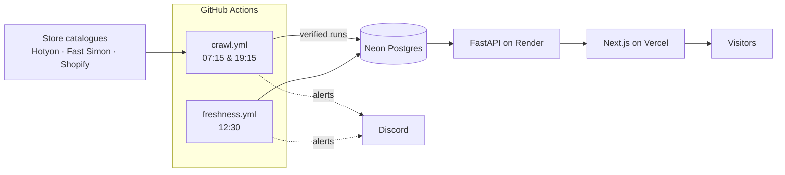

# Card Scout CA (tcg-tracker)

**Find the cheapest copy of any Yu-Gi-Oh! single across Canadian stores.**

**Live: https://card-scout-silk.vercel.app**


Canadian players compare prices by opening five store tabs and searching each one. Card Scout CA does that for
them: it checks every in-stock Yu-Gi-Oh! single at Canadian stores twice a day, matches the same printing across
stores, and shows who's cheapest for each edition and condition, with price history and a link to buy on the store's
own site.

Built by [kiunga400-hub](https://github.com/kiunga400-hub).

### Highlights

- **~50,000 live listings from three stores**, matched into one catalogue: ~2,760 cards are sold at both
  401 Games and Hobbiesville, ~9,000 at both Trinity and 401.
- **Every store's data, read from the source each store already uses.** Two stores serve their catalogue from a
  search provider's API (Hotyon, Fast Simon); the third uses Shopify's product feed. No HTML scraping and no
  headless browsers.
- **Shared card identity** (`CODE|rarity|art`): titles like `Ash Blossom & Joyous Spring [RA05-EN091] Ultra Rare`,
  `Ash Blossom - RA05-EN091 - Ultra Rare - 1st Edition` and tag-only data all resolve to the same card. Anything
  that can't be identified is quarantined, never guessed.
- **Trustworthy stock data:** stores hide sold-out cards, so "out of stock" is inferred from absence, but only from
  a crawl that passed completeness checks. A partial or suspicious crawl changes nothing.
- **Monitored like production:** every run is checked (item counts, parse-problem rate, field null-rate jumps,
  HTTP errors) and failures go to Discord, one channel per store.
- **Tested on real data:** 216 tests, including adapter tests on saved full crawls of each store and end-to-end
  `scrapy crawl` runs against a mock site. CI on Python 3.12 and 3.14 with Postgres 16.
- **Polite and permitted:** each store gave permission to be listed; robots.txt obeyed, one request at a time,
  `Retry-After` honoured, a contact address in the User-Agent. Rate limits are respected, never worked around.

**Stack:** Python, Scrapy, PostgreSQL, FastAPI · Next.js 16, React, Tailwind CSS, shadcn/ui, Recharts · GitHub Actions.

### How it runs (all free tiers, no PC needed)



| Piece | Where | Notes |
|---|---|---|
| Crawls | GitHub Actions (`.github/workflows/crawl.yml`) | migrations once, then one job per store in parallel; a crashed or timed-out crawl alerts on Discord |
| Freshness check | GitHub Actions (`freshness.yml`) | alerts if a store has had no good crawl for 26 h, which catches crawls that never started |
| Database | Neon (Postgres 18, free plan, 1 GB) | ~183 MB on 2026-10-27; CI tests on Postgres 16 |
| API | Render (`render.yaml`, free plan) | sleeps after 15 idle minutes, so the first request after a quiet spell takes ~30-50 s |
| Website | Vercel (`web/`) | redeploys on every push to `main` |

Secrets (`NEON_DATABASE_URL`, `TCG_CONTACT_EMAIL`, the Discord webhooks) live in GitHub Actions secrets and Render
environment variables, never in the repo.

### How it was built

I designed and directed this project and built it with an AI coding assistant (Claude Code). I chose the stores and
got each one's permission to list their prices, set the requirements (reliability, loud failures, tests on real
data), and made the product and engineering calls documented below: which data source to use for each store and
why, how card identity works, when a crawl is trusted, how out-of-stock is decided, and how to handle stores that
rate-limit bots.

## Stores

Prices in CAD, in-stock Yu-Gi-Oh! singles only:

| Store | Spider | Data source | Size (2026-10-26) |
|---|---|---|---|
| **Trinity Hobby** (trinityhobby.com) | `trinity` | Hotyon "USF" search API | ~11,800 listings, 59 requests |
| **401 Games** (store.401games.ca, Toronto) | `401games` | Fast Simon search API | ~35,000 listings, 141 requests |
| **Hobbiesville** (hobbiesville.com, Ottawa/Toronto) | `hobbiesville` | Shopify `products.json` | ~4,200 listings, 18 requests, ~2 minutes at 5 s pacing |
| **Fusion Gaming** (fusiongamingonline.com) | `fusion` | Shopify `products.json` | ~13,800 listings, 58 requests. **Not scheduled**: Shopify answered it with 429 at every pace we tried; the spider stays for manual runs |

Cards line up across stores on the same `card_key`: Trinity–401 share ~9,000, 401–Fusion ~11,500,
Trinity–Fusion ~4,200, and ~3,700 cards are at all three. Hobbiesville shares ~2,760 in-stock cards with 401 and
~1,830 with Trinity; ~1,380 are at all three scheduled stores (Trinity, 401, Hobbiesville).

## Website

`web/` is the front end (Next.js 16 App Router with cache components, Tailwind, shadcn/ui). It only talks to the
API below, never to the database.

| Page | What it shows |
|---|---|
| `/` | Search with suggestions as you type, deal of the day, stats, browse by set |
| `/search?q=` | Every printing matching a name or card number, cheapest price and number of stores |
| `/cards/[cardKey]` | Prices at every store per edition and condition, cheapest highlighted, links to buy, price history chart, other printings |
| `/sets`, `/sets/[code]` | Sets A–Z; a set's cards in number order with sort, rarity and store filters |
| `/deals` | Biggest savings for the same card, edition and condition between stores |
| `/stores` | Each store and when it was last checked |

Mobile first, dark mode follows the device. A store only appears while it has a complete crawl from the last 72
hours, so the site never shows stale prices.

```bash
npm --prefix web install
npm --prefix web run dev        # http://localhost:3000, needs the API on :8000 (API_URL to change)
```

## Quick start

Requires Python 3.12+ and PostgreSQL 16 (Docker or a local install).

```bash
python -m venv .venv
.venv/Scripts/pip install -r requirements-dev.txt     # Windows; on Linux/macOS: .venv/bin/pip
cp .env.example .env                                  # then edit: DATABASE_URL, TCG_CONTACT_EMAIL, alerts
docker compose up -d db                               # or a local Postgres, see below
python migrate.py                                     # applies migrations/NNNN_*.sql in order
scrapy crawl trinity                                  # one full crawl, about a minute
```

`.env` must be loaded into the environment before running (`set -a; . ./.env; set +a` in bash).
A crawl needs `TCG_CONTACT_EMAIL`: it goes in the User-Agent so the site owner can reach us.

**Without Docker on Windows:** PostgreSQL 16 from conda-forge, installed into the git-ignored `.tools/` folder:

```bash
.tools/micromamba.exe create -y -p .tools/pg -c conda-forge --override-channels postgresql=16
.tools/pg/Library/bin/pg_ctl.exe -D .tools/pgdata -l .tools/postgres.log start
```

`scripts/localdb.ps1` (init/start/stop/status) wraps this, reading passwords from `.env` (its `init` hasn't been
run end to end yet; the current database was set up by hand). The server isn't a Windows service: start it again
after a reboot.

### API (for the website)

A read-only FastAPI service in `api/` serves the data the front end needs (see `docs/frontend-plan.md`):

```bash
uvicorn api.main:app --reload --port 8000
```

Then open http://localhost:8000/docs to try every endpoint in the browser:

| Endpoint | Returns |
|---|---|
| `GET /api/search?q=dark magician&sort=best\|price\|stores\|name` | printings matching a name or card number, with cheapest in-stock price and store count |
| `GET /api/cards/{card_key}` | a card with every store's offers (edition, condition, price, link to the store), other printings |
| `GET /api/cards/{card_key}/history?edition=&condition=` | price history per store |
| `GET /api/sets`, `GET /api/sets/{code}` | sets with cards in stock (A–Z); a set's printings in card-number order |
| `GET /api/deals?condition=NM&min_price=5&sort=amount\|percent` | biggest savings for the same card, edition and condition |
| `GET /api/stores` | stores and when each was last updated |
| `GET /images/{card_key}` | the card's image: downloaded once from the store's CDN, then served from `.cache/images` |

Search ignores punctuation ("maxx c" finds `Maxx "C"`). The website's origin must be listed in `API_CORS_ORIGINS`
(default `http://localhost:3000`). Images are only fetched from Shopify's CDN, at 480 px width, with a 5 MB cap.

### Running on one PC instead (optional)

The live setup runs in the cloud (see *How it runs*). To run everything on one machine instead, `scripts/scheduled.py`
is what a local scheduler runs:

| Command | What it does |
|---|---|
| `scheduled.py crawl` | starts the local Postgres if needed, applies migrations, crawls every store, then backs up the database |
| `scheduled.py check-freshness` | alerts if a store has had no good crawl for `FRESHNESS_MAX_HOURS` (26) |
| `scheduled.py test-alert` | sends a test message to the configured alert channels |

On Windows, register the jobs once (you run this yourself; it creates tasks in a "tcg-tracker" Task Scheduler
folder for your user, no admin needed):

```bash
.venv/Scripts/python scripts/register_tasks.py
```

That schedules crawls at 07:15 and 19:15 and the freshness check at 12:30. A time missed while the PC was off or
asleep runs when it's back. `--remove` deletes the tasks. On Linux/macOS use cron:
`15 7,19 * * * cd /path/to/tcg-tracker && .venv/bin/python scripts/scheduled.py crawl`.
Twice a day is enough; don't crawl more often.

**Backups:** after every crawl, `pg_dump` writes `tcg-<timestamp>.dump` to `BACKUP_DIR` (default
`OneDrive\tcg-tracker-backups`, so a copy leaves the machine), checks it with `pg_restore --list` and keeps the newest
14 (`BACKUP_KEEP`). Restore with:

```bash
pg_restore -h localhost -U tcg -d tcg --clean --if-exists --no-owner <file>.dump
```

**Logs:** each job writes to `logs/` (git-ignored); the newest 60 are kept.

**Alerts:** to receive alerts on Discord, open your server's *Server Settings → Integrations → Webhooks → New
Webhook*, pick a channel, *Copy Webhook URL* and put it in `.env` as `ALERT_DISCORD_WEBHOOK_URL=...`. Then
`python scripts/scheduled.py test-alert` should post a message. Treat the webhook URL like a password: anyone with
it can post to that channel.

A store can have its own webhook (its own name and avatar in Discord, any channel): set
`ALERT_DISCORD_WEBHOOK_URL_<STORE>`, e.g. `ALERT_DISCORD_WEBHOOK_URL_401GAMES=...`, and test it with
`python scripts/scheduled.py test-alert --store 401games`. That store's crawl alerts go there; other stores and the
job-level alerts (backup, freshness, crashes) keep using `ALERT_DISCORD_WEBHOOK_URL`.

## Architecture

```
 store collection page ──(only when needed)──► API key / config (cached in store_config)
                                                   │
 store's search API ◄── pages of 200–250 ─────────┘     (Hotyon USF for Trinity, Fast Simon for 401 Games)
          │
          ▼
 tcg_tracker/spiders/<store>.py   paging, completeness checks, run verdict
          │  raw items
          ▼
 tcg_tracker/pipelines.py         spider.adapter(raw) -> CardRec -> db.save_items in batches of 500
          │                        start_run / finish_run bookkeeping
          ▼
 PostgreSQL                        stores, cards, listings, variants, price_history, scrape_runs
          │
          ▼
 tcg_tracker/monitoring.py        post-run checks -> log, scrape_runs.alerts, Discord, email
```

| Path | What it does |
|---|---|
| `tcg_tracker/spiders/trinity.py`, `games401.py` | Get the API config (cached), page the API to the end, decide if the crawl is complete |
| `parser.py` | Shared card identity (`CardRec`, `VariantRec`, `make_card_key`, art labels, grading) and Trinity's adapter |
| `adapter_401.py` | 401 Games' adapter: one Fast Simon item -> `CardRec` using the shared rules |
| `adapter_fusion.py` | Fusion Gaming's adapter: reshapes a Shopify product and reuses Trinity's parser (same BinderPOS conventions) |
| `adapter_hobbiesville.py` | Hobbiesville's adapter: card number, rarity, edition and set from structured `Key:Value` tags |
| `tcg_tracker/spiders/fusion.py`, `hobbiesville.py` | Shopify `products.json` crawl; Hobbiesville subclasses Fusion's spider with its own URL and settings |
| `api/` | Read-only FastAPI service the website uses (search, cards, history, sets, deals, stores, images) |
| `web/` | Next.js website |
| `.github/workflows/` | `ci.yml` (ruff + pytest), `crawl.yml` and `freshness.yml` (the cloud schedule) |
| `render.yaml` | Render Blueprint for the API |
| `db.py` | Batched upserts (COPY into staging tables + set-based SQL), price history, closing a run |
| `tcg_tracker/pipelines.py` | Glue: parse, save in transactions of 500, finish the run, tell the monitor |
| `tcg_tracker/monitoring.py` | Checks every run and sends alerts |
| `tcg_tracker/middlewares.py` | Honours `Retry-After` on 429/503 |
| `migrate.py`, `migrations/` | Numbered SQL migrations, each applied once in its own transaction |

### Data model

- **cards**: one row per canonical card (see *Card identity*), shared by all stores.
- **listings**: one store's product. Keeps the latest raw JSON (`raw`), so data can be re-parsed without
  re-fetching. `card_key` is NULL when the card couldn't be identified (quarantine); it is still tracked.
- **variants**: condition × edition offers within a listing, with price, quantity and `in_stock`. The edition lives
  here, not on the card: one listing can hold both 1st Edition and Unlimited copies.
- **price_history**: a row only when price, quantity or stock changes (`source='seen'`), or when a variant
  disappears from a complete crawl and is marked out of stock (`source='missing'`).
- **scrape_runs**: one row per crawl: status (`ok` / `suspect` / `failed`), counts, null rates per field, alerts.
- **current_best_prices** (view): cheapest in-stock offer per card, edition and condition across stores.

### Why runs can be "suspect" or "failed"

The API only returns in-stock items, so a card that sold out simply disappears. Disappearing is only trusted from a
**complete** crawl. A run is:

- **failed**: paging stopped early, an API page failed after retries, the item count differs from the API's
  `data.total` by more than 0.5%, out-of-stock items started appearing, or a database error happened;
- **suspect**: fewer than 90% of the items of the last good run;
- **ok**: otherwise. Only an ok run marks missing listings and variants out of stock (with history rows).

Nothing is ever deleted: a restocked card reappears with its history.

## Why the USF API and not Shopify's products.json

Trinity runs on Shopify, and Shopify stores expose `/collections/<handle>/products.json`. It doesn't work here:

- There is no Yu-Gi-Oh-only collection (`/collections/yugioh/` is empty). Yu-Gi-Oh singles are in the `singles`
  collection together with every other game: **258,643 products**.
- Shopify caps `page × limit` at **25,000** products per collection listing, so most of it can't be reached.

The store's search widget, Hotyon's "Ultimate Search & Filter" (USF), has an API filtered to exactly the Yu-Gi-Oh
singles (`collection=368535077111/yugioh`): plain GETs, no cookies, 200 items per page, all 11,793 items in 59
requests, ids unique across pages with `sort=-price`. It also returns per-variant quantities.

**The API key** is a public frontend key. It isn't in `usf-boot.js`; it's the `siteId` in the inline
`window.usf = { settings: {...} }` block of the collection page. The spider caches it in `store_config` and only
re-reads the page when the cache is older than 7 days or the API rejects the key (HTTP 400 "Missing or invalid
ApiKey."). That matters because trinityhobby.com answers unregistered bots with **429** on that page, while the
API never has. A hardcoded key in settings is the last resort and raises an alert.

**Politeness:** robots.txt obeyed on both hosts, one request at a time, 0.5 s delay plus AutoThrottle,
`Retry-After` honoured, contact address in the User-Agent. We don't use Shopify's Web Bot Auth: Shopify only
honours it after manually reviewing a registration, which a project like this is unlikely to get.

## Card identity

The same physical card is sold by many stores under different titles. `card_key` is the shared identity:

```
DIFO-EN070|super-rare|base
│          │          └ art / version label, or "base"
│          └ rarity (slug)
└ set code + language + number, as printed on the card
```

Rarity and art are part of the key because they change the price: a Starlight Rare and an Ultra Rare of the same card
number are different products, and so are Extended Art and base art.

**Edition is not part of the key.** It's stored on each variant (`1st Edition`, `Unlimited`, `Limited`), and prices
are compared per card, edition and condition. Some stores put both editions in one product (1,954 of Trinity's
11,793 listings do), others list one product per edition (401 Games, Face to Face); both map onto the same card.
(Migration 0005 moved edition out of `card_key`; keys were `CODE|rarity|edition|art` before.)

Where each part comes from (Trinity):

- **Card number**: `[DIFO-EN070]` in the title. Handles old codes without a language (`[MRD-142]`), special codes
  (`ENSE1`) and letter suffixes (`EN006K`).
- **Rarity**, most specific first: a tag (`Super Rare`, `Duel Terminal Technology Common`,
  `Rarity_Quarter Century Secret Rare`), a title parenthetical (`(UR)`, `(Starlight Rare)`), then the text after the
  code (`[HAC1-EN026] Common`, `[PHRE-EN039] - Phantom Revenge 1st Edition - Ultra Rare`). Text that isn't a
  rarity (`Promo`) is not used.
- **Edition** (per variant): the variant's option label (`Near Mint 1st Edition`), else the listing's edition tag
  (`1st Edition`, `Printing_1st Edition`).
- **Art label**: other title parentheticals (`(Extended Art)`, `(Green)`, `(MISCENTERED)`). A parenthetical that
  restates the rarity, like `(Ghost)` on a Ghost Rare, is not an art label.

**Quarantine:** anything that can't be identified gets `card_key = NULL` and a `problems` list instead of a guess.
On the saved crawl that is 2 of 11,793 listings: a "Promo" with no rarity, and a graded slab ("- PSA 7"). Graded
cards are never keyed, so they can't compete with raw copies. Variants are keyed by the store's variant id, never by
SKU (SKU is missing on ~5% of variants).

## Monitoring

After every crawl `RunMonitor` checks the run and raises alerts:

| Level | Check |
|---|---|
| critical | run failed or suspect; run never recorded (e.g. database down); items < 90% of the last good run; parser crashed |
| warning | > 2% of items with parse problems; a field's NULL share up > 2 points vs the last good run; > 5% of downloads failed; hardcoded or stale API key used; API key rejected |

Alerts always go to the log and to `scrape_runs.alerts`. Set `ALERT_DISCORD_WEBHOOK_URL` and/or the `ALERT_EMAIL_*`
/ `SMTP_*` variables in `.env` to also receive them. Thresholds are in `tcg_tracker/settings.py`.

## Tests

```bash
pytest                    # 216 tests, about 11 minutes (end-to-end crawls of three stores)
ruff check .
```

- Real full crawls, stored gzipped: `tests/trinity_yugioh_usf.json.gz` (11,793 items, 2.3 MB) and
  `tests/games401_fastsimon.json.gz` (35,027 items, 6.3 MB, untouched API output). Adapter tests run on them,
  including a check that both stores' keys line up.
- `test_e2e_spider.py` runs real `scrapy crawl` processes against `tests/mock_site.py`, which serves the saved crawl
  as API pages: no network.
- Database tests need `TEST_DATABASE_URL` pointing at a database whose name ends in `_test` (its schema is wiped);
  they're skipped otherwise. `scripts/bench_load.py` times a full load into that database.
- CI (`.github/workflows/ci.yml`) runs ruff and pytest on Python 3.12 and 3.14 with a Postgres 16 service.

## Adding a store

Get the store's permission first: each store is also a commitment to keep its scraper working.

401 Games was added this way; `adapter_401.py` and `tcg_tracker/spiders/games401.py` are the template. For another
Shopify store whose collection is under 25,000 products, subclass `FusionSpider` like `hobbiesville.py` does.

1. **Permission and rules.** Shopify stores' terms forbid scraping without written permission: have it first. Then
   check robots.txt and `agents.md`. See `docs/second-store-research.md` for how candidates were compared.
2. **Find the data source.** Prefer a structured API the site itself uses (search widget, JSON endpoints) over
   HTML. Count the items and confirm a full crawl is reachable (Shopify's `products.json` stops at 25,000).
3. **Save a real crawl** as a gzipped fixture in `tests/` before writing the adapter.
4. **Write the adapter** (`adapter_<store>.py`): `raw item -> CardRec`. Use the shared rules from `parser.py`
   (`make_card_key`, `art_label_from`, `GRADE_RE`, `_is_rarity_text`, `RARITY_ABBR`); quarantine instead of guessing;
   put the edition on each variant; fill `CardRec.title`. Measure how many keys line up with the other stores.
5. **Write the spider** in `tcg_tracker/spiders/<slug>.py` with `store` (`slug`, `name`, `base_url`), `adapter`
   (the function above) and `verdict(close_reason)`. Report where its config came from as `<slug>/config_source`
   so monitoring alerts on fallbacks.
6. **Tests:** adapter tests on real items, spider tests, and the mock site + end-to-end tests in
   `tests/mock_site.py` / `tests/test_e2e_spider.py`.
7. **Schedule it:** add the spider name to `SPIDERS` in `scripts/scheduled.py`.

## Known limitations

- **401 Games has no stock counts**, only "sellable" yes/no, so `quantity` is NULL for its variants.
- **401's "PLD" grade** is stored as its own condition `PL` (played): it has no published definition that maps to
  LP or MP, so best prices never compare it with those.
- **Edition unknown for some 401 products** (~1,560 listings, e.g. Dark Beginning / Dark Revelation, whose titles
  print no edition). They keep their card key but don't line up with another store's edition-specific offers.
- **Fusion Gaming has no set names** (`set_name` NULL): the set is one of ~680 mixed tags and isn't guessed; the
  set code in the card number identifies it. Its products.json `products_count` includes ~0.3% the feed doesn't
  list, so its count tolerance is 1%. Like 401, no stock counts (`available` only).
- **Shopify rate-limits bots by network, across stores.** On 2026-10-26 an evening of Fusion retries got the home
  connection 429'd at Hobbiesville too, while a crawl from another network got straight through. Keep Shopify
  traffic small (Fusion is off the schedule); the legitimate way past the limit is a Shopify crawler access key from
  the store owner, not disguised or rotated traffic.
- **Hobbiesville lists sold-out products** (69 with every condition unavailable): they're stored out of stock. Old
  codes like `MRL-E130` (no two-letter language) are quarantined, as everywhere.
- **Duel Terminal wording differs between stores**: Fusion's "(Duel Terminal) ... Parallel Rare" (40 cards) doesn't
  say which Duel Terminal rarity it is, so it doesn't match Trinity's "Duel Terminal Technology Ultra Rare" etc.
- **A 401 crawl takes ~25 minutes** (Fast Simon answers slowly, 5–15 s per page at times); Trinity takes ~1 minute.
  The scheduled job crawls all stores at the same time (one process each), so a run takes as long as the slowest.
- **History is per run.** Changes between two crawls are seen as one change; sell-outs and restocks between runs are
  invisible.
- **Stock is inferred from absence.** The API hides out-of-stock cards, so "out of stock" means "missing from a
  complete crawl". A suspect or failed run changes nothing, so stock can be stale until the next good run.
- **Paging needs a stable snapshot.** If many prices change during the ~1-minute crawl, `sort=-price` paging can
  skip or repeat items; the 0.5% count tolerance turns large drift into a failed run rather than bad data.
- **`available = -1`** (inventory unconfirmed, 4 variants) is counted as in stock. Below -1 (oversold) is stored as-is,
  out of stock, and flagged.
- **Unknown condition:** a product without option values (the graded slab) has variants with condition NULL.
- **Re-keying leaves old card rows.** When identity rules change, listings get their new `card_key` on the next
  crawl, but `cards` rows for keys no longer used remain (harmless; nothing references them). Raw JSON is kept in
  `listings.raw` if a re-parse tool is ever needed.
- **13 card keys are shared by two listings** of the same card at Trinity. Allowed: the view picks the cheaper.
- **The store page is rate-limited** (429). Runs normally don't need it (cached key); after 7 days the spider tries
  it again and falls back to the cached key if it's still blocked.
- **Free hosting limits.** The Render API sleeps after 15 idle minutes (slow first visit); Neon's free plan has 1 GB
  (183 MB used on 2026-10-27). `scripts/scheduled.py` and the Windows Task Scheduler setup remain for running
  everything on one PC instead.
